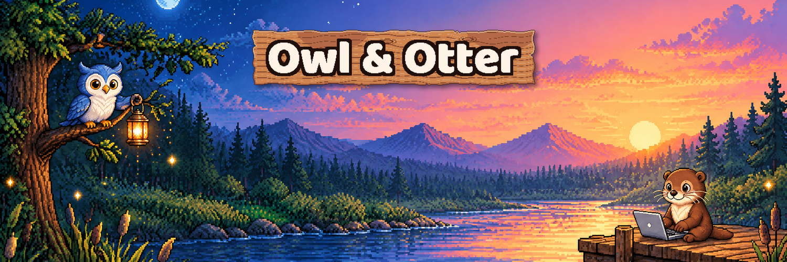
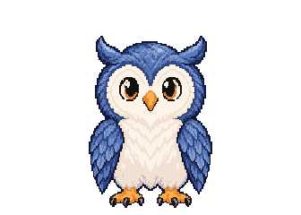
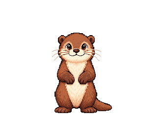

  

## One backend. Not four.

Sign-ins, store payments, lifecycle emails, push and in-app support for your iOS and Android app, in one SDK.

Most subscription apps glue together Firebase, RevenueCat, an email service and a chat widget. That's four SDKs, four dashboards, four bills, and webhooks between all of them. We're building one backend that replaces the lot, for solo developers shipping subscription apps.

It's free while you build. We're pre-launch, so the SDKs and samples will land here when they're ready.

## Find us

- Website and waitlist: [owlandotter.app](https://owlandotter.app)
- X: [@owlandotterapp](https://x.com/owlandotterapp)
- Bluesky: [@owlandotter.app](https://bsky.app/profile/owlandotter.app)
- Threads: [@owlandotterapp](https://www.threads.com/@owlandotterapp)
- Instagram: [@owlandotterapp](https://www.instagram.com/owlandotterapp)
- Email: [support@owlandotter.app](mailto:support@owlandotter.app)

Logos and character sprites are in [owlandotter/brand](https://github.com/owlandotter/brand). Found a security issue? See [SECURITY.md](https://github.com/owlandotter/.github/blob/main/SECURITY.md).

  
  

Owl & Otter is a trading name of ASB Media Investment Group. Hosted with love in the EU.

